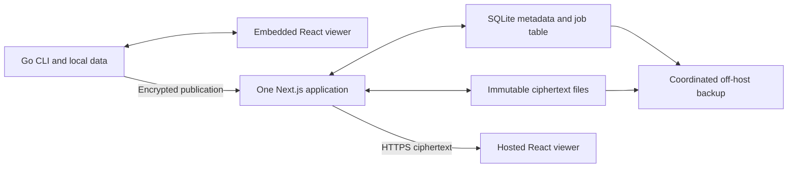
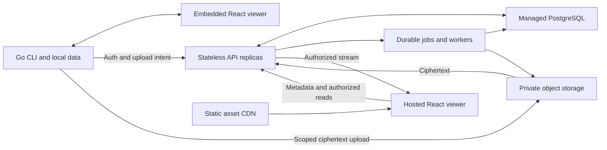

# session.link architecture alternatives

2026-10-11 · evaluated designs and trade-offs · grounded in the [current overview](architecture-overview.md) and [implementation review](architecture-review.md).

Subsequent decision on this date: replace the Go CLI and hosted runtime with
Rust and retain the React viewer. The [Rust migration plan](rust-migration.md)
is the execution plan and supersedes the language choices below. This comparison
remains useful for the single-host versus distributed-storage decision.

Both alternatives preserve the product's core contracts: one native CLI,
offline local reading, deliberate publication, an open document format, a shared
viewer and client-side encryption. They differ in where correctness and
availability are enforced. Alternative A puts transactions and lifecycle rules
inside one hosted application. Alternative B separates durable metadata and
blob delivery from replaceable application instances.

**Recommendation:** use A as the near-term default if a single active host and
restore-based recovery meet the offering's requirements. Choose B directly if
the hosted offering needs machine failover, concurrent growth or storage beyond
one local volume. There is no measured load baseline here that justifies a scale
rewrite by itself. Avoid changing the cryptographic protocol, storage system
and viewer model in the same migration.

Both proposals replace the current iroh FsStore dependency. They preserve
encryption and ordinary browser links, but would need a separate transport
design if direct peer delivery becomes a committed product requirement.

## Shared client and viewer structure

Keep the Go CLI's importers, recorder, spool protocol, immutable snapshots,
allowlist exporter and private receipts. These already express the right data
ownership. Keep headless publishing in Go so sharing does not require a browser
or an additional runtime. Make retry and grant-processing state explicit rather
than tying it to whether a particular UI page is open.

Keep React, but separate the document reader from its environment. A reader
core accepts a validated session; local and hosted shells provide document
loading, identity and available actions. Put browser cryptographic verification
behind a small protocol module, reusable by the server where suitable. The Go
implementation remains interoperable through shared test vectors. This is a
boundary cleanup within the existing packages, not a requirement to replace
them or introduce a state framework.

Build the viewer once per release into an immutable, versioned artifact consumed
by the binary and host. Record format/protocol versions and test compatible
version combinations. A host can upgrade its viewer without forcing immediate
CLI upgrades. None of this removes trust in the JavaScript supplied to a hosted
browser; stronger protection against a malicious host would require an
independently distributed trusted reader.

## Alternative A Transactional hosted monolith

**Optimize for:** a small team, modest hosted traffic, straightforward operation
and an optional compatible self-hosted deployment.

**Hosted offering.** Retain Next.js for account/login pages and APIs. Replace
mutable JSON collections with a SQLite database: users, credentials, share
records, recipient state, signed identity records, revision counters, quotas and
maintenance jobs. Replace the Rust/iroh adapter with ordinary immutable
ciphertext files behind a small `BlobStore` interface. Store signed payload
bytes unchanged; database normalization must not reserialize signed messages.
Keep identity updates and their expected head/revision checks in a transaction.

The database gets a unique index for owner, audience mode and ciphertext digest,
plus indexes for owner and recipient listings. Persist CLI approval attempts and
rate counters where restart continuity matters. A periodic in-process worker
handles expired attempts, abandoned uploads and eligible blob reclamation.
It does not receive content keys or issue sender grants.

**Publication flow.** After local preparation, the CLI uses the existing upload
API. The host reserves quota, streams ciphertext into a unique temporary file,
checks the envelope and digest, flushes and atomically installs the immutable
blob, then commits its share metadata before acknowledging. Database and file
operations are not one transaction: an interrupted operation can leave an
unreferenced blob. A leased upload record and idempotent reconciliation make
that state recoverable. Files must be durable before metadata exposes them.
Reads authorize against metadata and stream the immutable file without a
service-wide blob lock.

**CLI and viewer.** The CLI protocol can remain unchanged initially; pending
receipts still recover the same publication after an interrupted response. The
viewer continues decrypting whole v1 documents locally. Reader/shell separation
and release artifacts improve maintenance but are independently shippable.
An optional local grant worker could later let authorized invitations progress
without an open viewer. It must be opt-in and separate from recording; first
contact still waits if every approved sender device is offline.

**Gains.** This removes the Rust build and subprocess lifecycle, avoids directory
scans for account queries, and gives metadata changes transactional constraints.
Operations remain one application and one persistent data location. SQLite is
well suited to application-local storage with modest write concurrency, while
still allowing only one writer at a time. [SQLite deployment guidance](https://www.sqlite.org/whentouse.html)

**Costs and limits.** The active machine and volume remain a failure domain.
Restoration, not transparent failover, is the initial recovery mechanism. Peak
delivery still uses the host's network and disk. SQLite write transactions must
stay short; never hold one across email delivery or a large upload. Direct file
storage gives up iroh's ready-made verified-transfer machinery if peer delivery
later becomes a real requirement. Metadata and blob backups need a consistent
restore point; copying a live database file casually is insufficient. Use its
backup facilities and coordinate them with blob retention. [SQLite backup API](https://www.sqlite.org/backup.html)

**Migration.** First introduce storage interfaces under existing endpoints.
Import JSON metadata and byte-preserve identity envelopes. Export ciphertext
from FsStore, verify its digest, and retain each public ID, tombstone and access
policy; existing BLAKE3 identifiers can remain recorded without dictating the
new storage layout. Rehearse on a restored copy, briefly pause writes for final
cutover, and preserve the old store for rollback. Support legacy reads throughout;
migrate or explicitly retire legacy ingestion separately. No content decryption
is necessary for the storage migration.

## Alternative B Stateless service with managed storage

**Optimize for:** a hosted business that needs failover, independently scalable
delivery, growing account metadata and a durable operational job system.

**Hosted offering.** Serve versioned viewer and marketing assets through a CDN.
Keep Next.js for account UX if useful; run its APIs, or extracted handlers, as
stateless instances. Use managed PostgreSQL for accounts, recipient policy,
identity/vault revisions, upload state, quotas and transactional job records.
Use private object storage such as S3 for immutable ciphertext. Configure the
database for the actual failover and backup requirements; replicas alone do not
create an availability guarantee.

Replace process-local synchronization with database transactions, unique
constraints and expected-version updates. Grant issuance and device revocation
must lock/check the relevant identity rows in a consistent order, preserving
today's guarantee against a grant racing key rotation. PostgreSQL provides
row locks for this coordination. [PostgreSQL locking documentation](https://www.postgresql.org/docs/current/explicit-locking.html)

Persist CLI approvals and rate/admission state across replicas. A distributed
limiter can use database counters initially; add Redis only if measured demand
warrants another service. Workers process email delivery, upload finalization,
quota reconciliation, expiry and garbage collection from a durable queue or
transactional outbox. Keys remain on clients: a cloud worker cannot complete
the current sender-authorized grant handshake by itself.

**Publication flow.** A new CLI first saves its ciphertext and key, then obtains
an authenticated upload intent with a reserved quota and scoped upload URL.
It uploads ciphertext directly to object storage and requests finalization.
The service verifies size, supported envelope and a trustworthy ciphertext
checksum, seals a specific immutable object/version, and transactionally marks
the share ready. Only then does it return the stable share ID. Retrying intent
creation and finalization must reuse idempotency keys.

There is no cross-service transaction between PostgreSQL and object storage.
Staging states, leases and a reconciler must handle uploaded-but-uncommitted
objects, failed checks and expired quota reservations. A client-supplied digest
alone is not verification. Presigned S3 URLs can be reused until expiry and can
overwrite their target, so finalize by binding a verified object version or
promoting staging bytes into a client-unwritable immutable key.
[S3 presigned upload behavior](https://docs.aws.amazon.com/AmazonS3/latest/userguide/using-presigned-url.html)

**CLI and viewer.** The native binary gains a version-negotiated two-stage
upload transport while retaining local export, scanning and encryption. Existing
`POST /api/shares` clients continue through a compatibility handler that streams
to the new store; they must not be redirected into a transport they do not
understand. Keep old `/r/`, `/s/`, `/n/` links and v1 envelopes readable.

The hosted viewer fetches access metadata and decrypts ciphertext as today.
Move expensive parse/index work to a browser worker if profiling supports it.
Keep v1 whole-document loading until document size makes a versioned encrypted
manifest and chunks worthwhile; object storage alone cannot enable authenticated
partial decryption of the existing envelope.

Serve named ciphertext through an authorization gateway that rechecks each
download, so recipient revocation continues blocking new requests. Long-lived
object URLs would weaken that behavior: presigned URLs are bearer capabilities
valid until expiry. Bearer shares also need tombstone checks before delivery;
cache static assets freely, but do not expose permanent public blob URLs that
bypass deletion. [S3 access semantics](https://docs.aws.amazon.com/AmazonS3/latest/userguide/using-presigned-url.html)

**Gains.** Blob capacity and application instances no longer depend on a single
Fly volume. Metadata has query indexes and concurrency controls; direct uploads
avoid application buffering, and database-backed jobs survive application
restarts. The design supports rolling deploys and machine replacement when
the database, storage and gateway are provisioned for them. Managed storage
also offers a clearer place for retention and backup policies.

**Costs and limits.** More network boundaries mean more failure states, IAM
policies, metrics and restore coordination. Database, object storage, workers
and gateway introduce a larger operating and billing surface. Small payloads
gain an extra upload negotiation step. Deployment becomes harder to self-host.
Encryption still prevents server-side transcript search, content-specific
previews or AI processing unless clients perform that work or the product
explicitly changes its trust model. Hosted JavaScript trust and offline
first-recipient grants remain unchanged.

**Migration.** Introduce indexed metadata and object storage behind the existing
API first, with one authoritative writer. Backfill immutable blobs and verify
them against recorded digests. Cut over metadata and identity writes under a
controlled write pause, reconcile every share pointer, then enable multiple
application instances. Add direct uploads only after this path works. Preserve
an old-client compatibility suite; specify how rollback handles writes accepted
after cutover instead of assuming the old snapshot is current.

## Comparison

| Dimension | Current implementation | A Transactional monolith | B Stateless hosted platform |
| --- | --- | --- | --- |
| Hosted shape | One Next process, Rust subprocesses, local volume | One Next application, SQLite, ciphertext files | API replicas, PostgreSQL, private object storage, workers |
| CLI responsibility | Local capture, export, encryption, upload and key state | Same public contract initially | Same ownership, plus staged uploads and idempotent finalization |
| Viewer delivery | One source, embedded and manually copied bundle | Versioned shared artifact, local/hosted shells | Same shared artifact, CDN delivery; optional browser worker |
| Metadata correctness | JSON replacements and process-local locks; weaker legacy path | Database transactions and constraints on one host | Transactions, row locks and revision checks shared by replicas |
| Read/write bottleneck | Global blob lock, subprocess startup, directory scans | Host disk/network and SQLite writer | Provisioned database, gateway and object storage capacity |
| Failure recovery | One volume; restore rehearsal outstanding | Coordinated off-host restore; downtime accepted | Configured managed failover plus coordinated restores |
| Operating burden | Few services, several bespoke mechanisms | Lowest ongoing burden of the proposals | Highest; distributed failure handling is explicit |
| Migration effort | None | Moderate, with largely compatible clients | Higher, especially upload finalization and cutover |
| Named first-contact availability | Sender viewer must run | Same unless a local authorized worker is added | Same; cloud workers do not hold sender keys |
| Encryption guarantees | Client encryption; trusted viewer delivery | Preserved | Preserved |
| Best fit | Current early offering while risks are addressed | Small team prioritizing predictable operation | Hosted availability and growth justify managed dependencies |

Relative effort and operating burden are engineering judgments, not price or
throughput estimates. Neither proposal needs microservices per domain, a CLI
language rewrite or a new cryptographic protocol to deliver its primary benefit.

## Decision and first steps

Prioritize a real restore rehearsal, protocol conformance tests and review,
storage quotas/lifecycle rules, and a release gate spanning both repositories.
Add content-free operational measurements before selecting capacity targets.
These steps pay off under either architecture.

Proceed with A if a documented recovery interval is acceptable and one host can
meet measured load with headroom. If host failure must not interrupt share access,
or capacity measurements already justify distributed storage, go directly to B
and avoid an interim persistence migration. Improving named-recipient availability
is a separate client/protocol decision in both cases.
