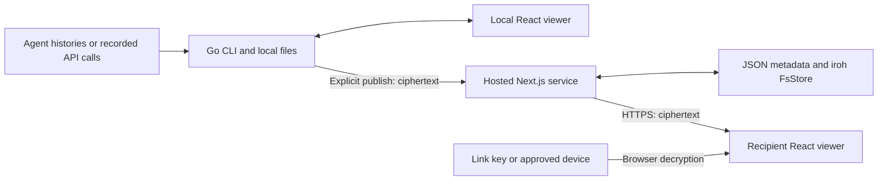

# session.link architecture overview

2026-10-11 · current architecture · companion [review](architecture-review.md) and [alternatives](architecture-alternatives.md).

session.link turns agent histories into readable, deliberately published,
encrypted documents. Its architecture has three parts: a native Go CLI that
owns local data and publishing, a shared React viewer, and a hosted Next.js
service that manages accounts, access and durable ciphertext. The public
`session-link` repository contains the CLI, format and viewer; the sibling
`session-link-server` repository contains the hosted offering.

**CLI and capture.** `slink view` discovers existing histories, imports them
into the open `session/v0` JSON format, saves an immutable preview and opens a
loopback web server. Eight harness adapters cover Claude Code, Codex, opencode,
pi, omp, DeepSeek Harness, Aider and experimental Hermes. Alternatively,
`slink record`, the optional `tap` proxy, or the pi extension capture calls
while work runs. Imports are marked reconstructed; recording retains available
request/response evidence. Append-only spools, locking and recovery protect
interrupted captures. Private files under `~/.slink` hold captures, previews,
drafts, credentials, device keys and share receipts. Local reading needs no account.

**Viewer and publication.** One React/TypeScript source tree supplies the
bundle embedded in the Go binary and the bundle served by the host. It derives
conversations and exchanges from spans, renders Markdown and raw evidence,
supports search and anchored links, and lets senders select excerpts and add
notes. The Go exporter constructs excerpts from an allowlist; omitted source
content is absent from the exported document. Local requests require a
per-launch access capability, with additional guards on mutations. Publishing
validates, scans for credentials and encrypts the exact export using a fresh
AES-256-GCM key. A saved pending receipt preserves retryability. Current clients
never fall back to plaintext uploads.

**Hosted offering.** Next.js serves marketing, documentation, login, accounts,
viewer shells and APIs. GitHub OAuth and email links/codes identify accounts;
Resend delivers authentication email. Browser cookies and separately revocable
CLI API keys authorize service access. Encrypted blobs live in iroh-blobs FsStore,
accessed through a short-lived Rust subprocess; ownership, tombstones, identity
histories and encrypted vaults live in JSON files. Delivery is HTTPS: there is
no deployed iroh peer network. Live status on this date showed one Fly machine
in Amsterdam, one shared CPU, 512 MB RAM and a 1 GB volume, at release 58.

**Access and trust.** `/s/<id>#key=…` grants access through possession of the
complete link; the fragment key stays out of HTTP requests. `/n/<id>` requires
an invited account and approved encryption device. A secret-bound invitation,
recipient claim and sender-signed key grant establish access; completing a new
grant requires the sender's local viewer to run. Signed device histories and an
encrypted vault support device approval, revocation and recovery. Account login
alone cannot decrypt. The service sees ownership/access metadata, and its
delivered JavaScript remains trusted with decrypted content and browser keys.

**Architectural limits.** Process-local locks and rate limits require one
hosted writer; encrypted documents are downloaded and decrypted whole, capped
at 25 MiB of plaintext. Deletion hides a share but retains its blob; revocation
cannot erase received copies. Legacy `/r/` links remain server-readable.
The strongest foundations are local ownership, immutable exports and the shared
viewer. The next priorities are rehearsed recovery, transactional metadata,
storage lifecycle controls and independent review of the identity protocol.
