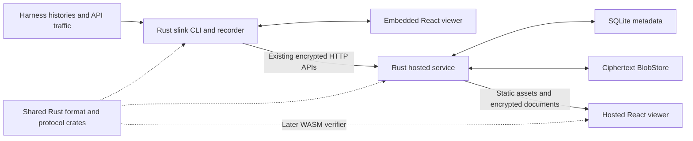

# session.link Rust migration plan

2026-10-11, revised 2026-10-12 · Rust direction agreed; implementation plan · nothing is migrated, see [Starting fresh](#starting-fresh) · P0 is under way in the [compatibility baseline](compatibility-baseline.md); the workspace and first build are in [rust-build.md](rust-build.md).

Replace the Go CLI and recorder with Rust, replace the hosted Next.js runtime
with a Rust service, and share protocol logic between the native applications.
Keep React and TypeScript for the viewer and the pi extension. The product
keeps its `slink` command, harness support, format, viewer and sharing design.
Nobody uses the software yet, so no local data, account, recovery key or
published link is carried across; [Starting fresh](#starting-fresh) says what
that removes from this plan.

The Go replacement is a required outcome of this plan. It is not conditional on
a later decision about whether Rust is worthwhile. Performance measurements
guide implementation and catch regressions; the strategic goal is a maintained
Rust foundation shared by the CLI and service.

This supersedes the language recommendations in
[architecture-alternatives.md](architecture-alternatives.md). The
[current architecture](architecture-overview.md) remains the deployed baseline.
The older [Go migration](go-migration.md) remains a historical record.

## Starting fresh

Decided 2026-10-12: nobody uses the software yet, so nothing is migrated, and
either implementation may start from empty state where that is simpler.

Out of the plan:

- reading, converting or resuming anything the Go CLI wrote: homes, captures,
  drafts, receipts, pending uploads, device keys and spools;
- keeping accounts, sessions, API keys, recovery keys, vaults or published
  links from the Node service, and importing its JSON metadata or blob store;
- old clients against the new server, upgrade and downgrade exercises, and
  rollback onto state the other implementation wrote;
- restoring the current hosted volume.

Still in:

- the product contracts below, as the behavior of the new implementation;
- the format, envelopes and signed histories as they are, because the viewer
  and the pi extension are not ported and implement them in TypeScript. A
  change to one of them lands on both sides in the same change;
- the fixtures and protocol vectors as oracles, and the Go binary as the
  reference executable until the Rust CLI replaces it. A deliberate difference
  from Go is declared in the
  [compatibility baseline](compatibility-baseline.md), never normalized away;
- the safety rules: private file modes, no publication without the user's
  action, no plaintext fallback, and checks that never touch a real home.

Two guards cost little and stay. A `slink` that finds a home it does not
recognize leaves it untouched and says so. The hosted switch does not delete
the old volume.

This holds while there are no users. From the first one, a change to the home
layout, the hosted schema or the protocol needs a migration again.

## Target architecture

Two native executables form the production application: public `slink`, including
the recorder and loopback viewer server, and private `slink-server`. The hosted
service remains a modular monolith on one active host during this migration.
Its metadata is in SQLite from its first release. React assets are built once and
embedded or packaged with both executables; Node remains a build tool and the
existing optional npm launcher environment, not a required native CLI or hosted
server runtime.

The Rust service starts with an empty store, so the ciphertext backend is
chosen once, behind a `BlobStore` interface, and the current iroh FsStore
layout is not carried over. Integrate a long-lived iroh store only after crash
and durability checks establish its acknowledgement semantics, on a release
selected and pinned through a separate check: the currently pinned 0.103.0
documentation explicitly warns about production quality. If a supported,
durable path cannot be established, use immutable ciphertext files. The choice
does not change keys, URLs or envelopes.
[iroh-blobs version documentation](https://docs.rs/iroh-blobs/0.103.0/iroh_blobs/)

The CLI and the hosted service are still separate releases. Preserve current
sharing behavior throughout. A local background grant worker, peer delivery, attachments,
chunked encryption, new identity protocols and multiple hosted writers remain
separate projects. In particular, porting to Rust does not remove the current
sender-online requirement for new named-recipient grants.

## Repository and module boundaries

Keep the existing public/private repository boundary. Add a Cargo workspace at
the public repository root alongside `go/` and `packages/`. Organize the native
code as follows; create crates when their first implementation lands rather
than filling the repository with empty packages.

| Proposed location | Responsibility and dependency boundary |
| --- | --- |
| `crates/slink-format` | `session/v0` loading, schema/invariant validation, secret scanning and open-world data preservation. No network or application state. |
| `crates/slink-protocol` | Envelope codecs, signed-history rules, named-share statements and cryptographic operations. Separate deterministic rules from random generation and platform key access. |
| `crates/slink-local` | Private file writes, locks, spool/recovery, previews, draft revisions, excerpt export and local identity persistence. |
| `crates/slink-import` | Harness discovery, explicit session resolution and the eight importer adapters. |
| `crates/slink-client` | Hosted API transport, login, pending publications, vault synchronization and named grants. It composes protocol and local storage. |
| `crates/slink` | CLI dispatch, recorder/proxy, local HTTP routes and operating-system integration. Keep these as modules until an actual reuse boundary calls for another crate. |
| `crates/slink-protocol-wasm` | Later browser bindings to shared verification rules, with generated TypeScript types. No native filesystem dependencies. |
| Private server repository `crates/slink-server` | Hosted routes, account authentication, escaped HTML templates, authorization, metadata, blob storage and operational jobs. Reuses public format/protocol crates. |

The private server pins public crates to immutable revisions during development;
releases record the exact revision and Cargo lockfile. Local path overrides are
development-only. The public build must never depend on the private repository;
private CI checks out both repositories at explicit revisions for integration.
Cargo workspaces and dependency overrides support this arrangement.
[Cargo workspaces](https://doc.rust-lang.org/cargo/reference/workspaces.html),
[dependency overrides](https://doc.rust-lang.org/cargo/reference/overriding-dependencies.html)

Use Tokio and Axum for native HTTP services, reqwest with an explicitly selected
TLS backend for the publishing client, and rusqlite with bundled SQLite for
harness database reads and later hosted metadata. Run blocking database work
outside async executor threads and bound concurrency. Bundling SQLite adds a
native C build requirement that the current pure-Go distribution avoids; prove
all release targets early. These are implementation defaults, with exact versions
locked after the first build spike.
[Axum](https://docs.rs/axum/latest/axum/),
[reqwest](https://docs.rs/reqwest/latest/reqwest/),
[rusqlite](https://docs.rs/rusqlite/latest/rusqlite/)

Keep `packages/format/session.schema.json` and the generated secret-pattern
artifact authoritative during the port. Use established cryptographic libraries
for the existing AES-GCM, Ed25519, X25519 and HKDF operations; preserve every
domain separator, encoding and validation rule. The migration introduces no
new cryptographic construction.

## Product contracts

What the Rust implementation must do. "Current" means the Go CLI and the Node
service at the revisions the
[compatibility baseline](compatibility-baseline.md) pins. These are contracts
on behavior; none of them requires reading state the current implementations
wrote.

| Contract | Required behavior |
| --- | --- |
| Commands | Every command, alias, flag, environment variable, exit code, stdout/stderr convention, non-TTY confirmation and `--` argument boundary in the current CLI. Preserve stable machine output; incidental help spacing may differ. |
| Discovery and import | All eight harnesses, project walk-up rules, explicit IDs, ambiguity errors, resumed branches, child agents, image references and honest fidelity. Do not reduce support to the easiest file importers. |
| Documents | Read and write `session/v0`; retain unknown vocabulary and fields. Preserve source/raw data and exact bytes wherever used for signatures, hashes, pending uploads or immutable documents. The pre-rebrand `run/v0` name need not be accepted once the public examples are stored as `session/v0`. |
| Excerpts | Same catalog identities, source order, UTF-16 passage offsets, citation inclusion, omission rules and author-note separation. An unchanged saved export produces the same bytes again. |
| Local home | `SLINK_HOME` and the default `~/.slink`, with restrictive permissions and OS locking. Config, previews, drafts, titles, share receipts, pending envelopes, device keys and unfinished setup state keep their behavior; the layout that holds them may change. |
| Recorder | The spool protocol as the recorder's own crash contract, HTTP forwarding and SSE behavior, session segmentation, partial-capture reporting, child exit status and bounded shutdown. Preserve upstream traffic even when capture is incomplete where the current contract allows it. |
| Local browser | Existing routes and actions, fragment access capability, host/origin checks, access headers, CSP, background operation, stop control and SSH-forwarding path. |
| Encryption and recovery | Existing envelopes, signatures over exact bytes, recovery tokens, root/head pins, vault versions, CAS, key rotation, invitation proofs and revocation behavior. Accounts and devices enroll again on the new service. |
| Hosted API and URLs | `/s/`, `/n/`, identity, account, login and CLI approval routes; status/error semantics, ownership, dedupe and tombstones. `/r/` and raw downloads only as far as `/examples` needs them. New clients never fall back to plaintext upload. |
| Accounts | Linked login methods, API key hashing, cookie verification, OAuth/email challenge semantics and persistent service secrets. Account IDs, sessions and keys start again. |
| Distribution | `slink`/`slink.exe`, current archive naming, installer checksums, Homebrew, npm package names, Linux packages and all six OS/architecture combinations. |

Port contracts, not accidental weaknesses. Each discovered mismatch gets either
a compatibility test or a documented correction with a targeted regression
test. In particular, fix unsafe legacy write races and evaluate the documented
Windows/wrapper spool-liveness limitations rather than freezing them as desired
behavior. A correction that changes what the viewer or the pi extension reads
or writes lands in them in the same change.

Typed Rust structures must not discard unknown fields. Retain original buffers
and raw JSON slices where exact representation matters; typed views can sit
alongside them. Do not reconstruct signed payloads from parsed values. JSON
number handling, Unicode, escaping and key order need explicit differential
tests. Serde's raw-value support is one useful mechanism, not a substitute for
the complete preservation contract.
[serde_json RawValue](https://docs.rs/serde_json/latest/serde_json/value/struct.RawValue.html)

## Milestones and exit gates

The delivery order is P0 through P7. The browser consolidation milestone P8
follows native parity. Server preparation can use the shared crates earlier,
but the stable CLI release precedes the hosted switch so the Rust CLI is first
exercised against the existing server.

### P0 Freeze the reference

- [x] Record exact client/server revisions, released client versions, viewer
  digest and the supported harness-version matrix.
- [ ] Extract command and environment-variable contracts from
  [CLI help](../go/cmd/slink/help.go), flag definitions and tests. Record all
  hosted routes and observable responses from the server and smoke suites.
- [x] Build a differential runner using fictional fixtures and isolated homes.
  Classify comparisons as byte-exact, JSON-equivalent or behavioral. Normalize
  only documented nondeterminism such as generated times and IDs; never strip
  meaningful differences to make tests pass.
- [ ] Extend the fixtures with unfinished identity setup, pending ciphertext,
  named outboxes, torn spools and negative histories as each area is ported.
  Keep Go and Node implementations available as reference executables.
- [ ] Measure baseline binary/download size, startup, recorder idle/active RSS,
  streaming overhead, local first render and hosted upload/download latency.

**Exit:** the reference suites pass, comparisons explain every exception and
baseline results are recorded. Recovery objectives and the restore rehearsal
are in P7, where they apply to the new store.

### P1 Establish the Rust core and build pipeline

- [x] Add the workspace, pinned toolchain, lockfile, formatting/linting and native
  test jobs. Build a minimal executable for all six distribution targets.
- [x] Implement format validation, invariant checks and generated secret-pattern
  consumption against the current JS/Go validators.
- [x] Implement envelope and signed-history verification against Go/Web
  Crypto vectors.
- [x] Then wrapping, recovery and named statement codecs against the same
  vectors, with signing and device requests.
- [ ] Add injectable clocks/randomness for deterministic tests; production uses
  operating-system randomness. Inject crashes/I/O failures at persistence seams.
- [ ] Build the viewer into a neutral artifact directory with an asset manifest
  containing source revision, digests and protocol versions. Keep generating the
  Go embed from that same artifact while Go is the reference.

**Exit:** schema, scan, encryption and negative-protocol fixtures agree across
implementations. The prototype embeds the real viewer. Native TLS and bundled
SQLite build on every target. No Rust executable writes to a user's real home.

### P2 Complete local reading and composition

- [x] Port discovery and every importer: Claude Code, Codex, opencode, pi, omp,
  DeepSeek Harness, Aider and Hermes, preserving Hermes's experimental status.
- [x] Implement `import`, `list`/`ls`, session resolution and immutable preview
  reuse.
- [ ] Read live captures without taking over an active recorder's spool. Left
  to the recorder in P4, where the spool's reader and writer are ported
  together; [rust-cli.md](rust-cli.md#not-done) has the reason.
- [x] Port the loopback server and `view`/`open`, including background processes,
  fixed-port failures, browser launch, SSH guidance and stop behavior.
- [x] Port catalogs, UTF-16 selection, revisioned drafts, saved views, source
  reference checks and allowlist export. Retain the existing React components.
- [x] Run the pi handoff tests against the Rust executable.

**Exit:** all eight adapters match the fixture contract; the existing real-browser
viewer/security scripts pass against Rust. The omitted-content marker is absent
from the entire excerpt, including raw and download channels. An opt-in
`slink-rs` binary can perform local workflows in an isolated home.

On 2026-10-12 the exit holds on macOS arm64, with reading a capture that is
still being recorded left to P4. [rust-cli.md](rust-cli.md) has the evidence
and what the six targets have yet to run.

### P3 Complete publication and private identity

- [x] Implement `login`, `logout`, `push`, `share` and `delete`, with exact
  server-origin rules, redirect behavior, caps, confirmation and error handling.
- [x] Write a durable pending receipt before upload, resume it after a lost
  acknowledgement, and keep successful links when backup fails.
- [x] Port native setup, approval, recovery, revocation, unfinished-setup discard,
  vault merge/CAS retries and account-scoped receipts.
- [ ] Port named invitations, claims, grant verification, outbox recovery,
  recipient revocation and the existing viewer-driven resume loop.
- [ ] Review the Rust protocol port independently and resolve release-blocking
  findings before stable distribution; retain the broader protocol review task.

**Exit:** Rust publishes to the existing Node server, browser recipients open the
result, and a second device recovers Rust-created links. An interrupted upload
resumes. Rotation, substitution, rollback, tampering and concurrent-vault cases
pass. Content keys never enter HTTP requests, logs or plaintext server storage.

On 2026-10-14 the first three items hold on macOS arm64: Rust publishes to
the existing Node server, a browser opens the result, an interrupted upload
resumes, and a third machine recovers a Rust-created link with the recovery
key, through the settings page against the service's smoke server.
Rotation, substitution, rollback and concurrent-vault cases pass in the
client's tests, and its journey passes against the service's own identity
store. Tampered statements are the protocol crate's shared cases, and every
answer is verified by that crate. No content key, recovery key or text
reached a request to the service or its storage in those runs. Named shares
remain. [rust-client.md](rust-client.md) has the evidence and where Rust
refuses what Go accepts.

### P4 Complete recording and operating-system integration

- [ ] Port Anthropic/OpenAI forwarding, SSE reassembly, capture gaps, segmentation,
  spool append/snapshot/finalize, ownership, recovery and pruning.
- [ ] Port `record`/`dev`, `tap`, `setup`, `on`, `off`, `status`, `prune`,
  `doctor`, `completion`, `version` and `help`, including platform-specific
  service installation and removal where currently supported.
- [ ] Verify child signals, exit codes, streaming cancellation, concurrent calls,
  long idle periods, full disks, torn writes and failed finalization.
- [ ] Preserve macOS launchd and Linux user-systemd identities and restart the
  recorder cleanly during upgrade. Never start a second recorder for the same
  endpoint or kill unrelated viewers/recorders by a broad process pattern.
- [ ] Establish explicit request/capture resource bounds without silently
  truncating or altering upstream requests. Add partial-capture indicators when
  recording is limited, and document any deliberate behavior correction.

**Exit:** the full CLI contract is implemented. Crash tests preserve completed
captures, and a reader never takes over a live recorder's spool. OS service
lifecycle checks and resource benchmarks pass. Rust does not delegate unported
commands to Go.

### P5 Replace the distributed Go CLI

- [ ] Run a prerelease with isolated profiles. A home the Go CLI wrote is not
  converted: if the layout changed, the home carries a version marker, and a
  `slink` that does not recognize a home leaves it untouched and says how to
  start a new one.
- [ ] Replace Go compilation in packaging with Cargo-built artifacts. Preserve
  archive/checksum contracts and all npm platform package names; publish the
  launcher after its exact-version platform packages are available.
- [ ] Build and test macOS x86-64/ARM64, Linux x86-64/ARM64 and Windows x86-64/ARM64.
  Use an explicit Linux libc baseline, bundled SQLite and tested TLS roots;
  verify on clean machines without a development toolchain. Emulation-only
  results must not be reported as native runtime tests.
- [ ] Preserve `.deb`, `.rpm`, `.apk`, Homebrew and install-script behavior.
  Retain the existing trusted-publisher workflow identity until npm trust is
  deliberately reconfigured; a workflow filename rename can break publishing.
- [ ] Cut the first stable Rust `slink` release against the existing hosted
  service. Update user/install docs and regenerate the hosted documentation.

**Exit:** every supported distribution installs and completes read/share flows.
Rust is the default binary across channels, with no Go runtime or fallback.
The Go build leaves packaging in that release; its last tag remains the
reference.

### P6 Replace the hosted runtime

- [ ] Implement the hosted HTTP surface with the same external routes:
  encrypted and named shares; identity; GitHub and email login/linking; CLI
  approval; account/key administration; health checks. Port the plaintext `/r/`
  reader and raw download only as far as `/examples` needs them.
- [ ] Replace Next-specific page rendering with escaped Rust templates and the
  existing React viewer. Preserve `/account`, `/login`, `/cli`, `/devices`,
  `/examples`, `/demo`, marketing/docs/install assets, redirects, link previews,
  noindex behavior, CSP, framing and theme behavior.
- [ ] Keep the cookie, API-credential, email-attempt and origin-guard designs.
  Accounts, sessions and keys themselves start again. Port operator
  key-management commands so running the service requires no Node scripts.
- [ ] Store metadata in SQLite from the first release: tables and indexes for
  accounts, API credentials, shares, recipient state, identity records and
  upload state. Preserve exact signed payload bytes and identity revision
  checks in transactions; keep transactions short, database work bounded and
  blob I/O streaming. There is no JSON-compatible stage and no importer.
- [ ] Choose the blob backend behind an adapter after verifying durable
  acknowledgements under process kill and restart: iroh if a pinned release
  passes, immutable ciphertext files otherwise. Do not assume that a
  long-lived process is automatically durable.
- [ ] Run the Rust CLI and the real-browser email, encrypted-share, identity
  and named-share smoke suites against scratch stores. Replace the Docker
  runtime and retain the current Fly domain and region. Start on an empty
  store and seed the public examples into it.

**Exit:** Rust serves the entire hosted offering and its operator commands on
transactional metadata, with no per-request blob subprocess in the normal path.
The Rust CLI and the hosted viewer pass the smoke suites against it. The switch
is a deployment onto an empty store: links, accounts and keys created on the
Node service stop working, and the old volume is left in place.

### P7 Harden hosted operations and retire the legacy runtimes

- [ ] Add quota reservations, maintenance jobs, orphan reconciliation and
  content-free operational metrics. Document logical deletion, grace periods
  and backup expiry; physical blob deletion requires a validated retention
  implementation and restore exercise.
- [ ] Define recovery objectives and rehearse a consistent SQLite/blob restore
  of the new store, including encrypted vaults, histories, tombstones and
  service secrets.
- [ ] Retire the Node runtime code and the Go implementation, preserving
  fixtures and reproducible historical artifacts.

**Exit:** native Rust CLI and server are the maintained production
implementations. Retention and recovery procedures work on the new store.
One-host availability limits remain explicit; multiple writers or managed
PostgreSQL/object storage would be a later architecture change.

### P8 Consolidate browser verification

- [ ] Compile the deterministic protocol verifier to WASM and test the same
  positive/negative corpus against native Rust and the existing TypeScript verifier.
- [ ] Keep IndexedDB, Web Locks, UI and non-extractable browser private keys
  behind JavaScript/Web Crypto adapters. Never export those keys to accommodate
  a shared native API.
- [ ] Version the JS/WASM bundle together and test local embedding, correct MIME
  types, CSP, supported browsers, startup failures and offline local viewing.
  Any required CSP change must be narrow and covered by the existing security checks.
- [ ] Replace duplicate TypeScript history-transition logic after parity and
  acceptable load/memory results. Preserve independent test vectors as the oracle.

**Exit:** shared Rust rules verify identities in the native client, server and
browser, with React still rendering the product. WASM need not block the Rust
CLI or hosted runtime releases; it is a separate consolidation milestone.
[wasm-bindgen guide](https://wasm-bindgen.github.io/wasm-bindgen/)

## Release verification

The verification matrix is:

| Client and viewer | Node reference server | Rust server |
| --- | --- | --- |
| Go CLI and its embedded viewer | Baseline | Not required |
| Rust CLI and its embedded viewer | Must pass before the CLI release | Must pass |
| Existing hosted browser viewer | Baseline | Must pass |
| Viewer with Rust WASM verification | Protocol parity | Must pass before browser cutover |

Run the existing browser checks against the actual built executable and server,
not replacements of their APIs. Native tests include platform file locks and
atomic writes; property/fuzz tests target arbitrary JSON, nested spans, SSE,
UTF-16 passages, envelopes and identity transitions. Unsafe Rust in application
code requires a narrow, documented reason; dependency review includes native
SQLite and cryptographic code rather than assuming the language proves safety.

Benchmark small, representative and near-limit sessions, including concurrent
recording and slow recipients. Record hardware, OS, release build, sample counts,
p50/p95 latency and peak RSS. Establish numeric budgets in P0. Investigate
sustained regressions over 10% on the same workload before release and document
any accepted trade-off. Track installed/archive sizes per target and reconcile
the README's size promises with measured artifacts. No claimed efficiency win
is complete until measured.

## Switching over

Nothing is converted in either switch; see [Starting fresh](#starting-fresh).

For the CLI, the Rust release replaces the Go binary on every channel. If the
home layout differs from what Go wrote, the home carries a version marker, and
a `slink` that finds a home it does not recognize leaves it untouched and says
how to start a new one. An installer replaces the executable only after
recorder shutdown/drain, then restarts the configured service.

For the hosted service, the Rust deployment starts on an empty store. Validate
it with synthetic shares and identities before the domain points at it; until
then, going back is redeploying the Node image, whose data is still in place.
After the switch, going back to Node loses whatever the Rust service accepted
in between, which is acceptable only while there are no users.

Do not shadow real publication, key issuance, recovery or email delivery into a
second writer. Synthetic tests are sufficient. Version app binaries, the
metadata schema and viewer artifacts separately so operators can identify the
actual compatible combination.

## First implementation backlog

Each item is a reviewable change with an explicit result. The milestone gates
above remain authoritative; merging scaffolding does not complete the port.

| Order | Change | Completion evidence |
| --- | --- | --- |
| 1 | P0 compatibility manifest and baseline runner | Current binaries pass the runner; command/API inventory and fixture classifications are recorded |
| 2 | Cargo workspace and six-target native build spike | TLS, SQLite and embedded viewer build; release artifacts install on the test matrix |
| 3 | Neutral viewer artifact plus manifest | Existing Go/server outputs still match; Rust consumes the same artifact without a source copy |
| 4 | Rust format validator and scanner | All existing goldens plus unknown-field and invalid-document cases agree |
| 5 | Rust envelope/history verifier | Go/Web Crypto fixtures and negative protocol corpus agree; malformed inputs fail safely |
| 6 | Rust CLI shell, first importer and local reader | One complete local journey works under isolated `SLINK_HOME`, with publication unavailable until implemented |
| 7 | Remaining importers, drafts and exporter | P2 gate passes, including all harnesses and omission checks |
| 8 | Publication, identity, recorder and platform slices | P3/P4 gates pass before any stable replacement release |

The first planning checkpoint follows items 1–2: use measured build portability,
baseline costs and contract inventory to size the remaining work. Importer
fidelity, private identity state, OS process behavior and hosted authentication
are the largest uncertainty areas. Keep the CLI and server releases as
separate milestones even if implementation work overlaps.

## Completion checklist

- [ ] Rust `slink` replaces Go in every distribution channel and supports the
  full command/harness matrix without a hidden Go fallback.
- [ ] The Rust service replaces the deployed Next.js/Node runtime, including
  authentication, account pages, the examples reader and operational commands.
- [ ] Nothing depends on state the Go CLI or the Node service wrote: the Rust
  CLI runs on a home it created and the Rust service on a store it created,
  with the public examples seeded into it.
- [ ] Shared Rust protocol code serves both native applications, with browser
  verification consolidation completed through P8.
- [ ] Real-browser, crash/recovery, cross-version and cross-platform checks pass;
  measured resource results and any exceptions are recorded.
- [ ] SQLite metadata, the selected blob backend, release provenance and the
  restore procedure are documented and exercised.

The migration is complete when these outcomes hold, not when the code compiles
or the default executable is renamed.
